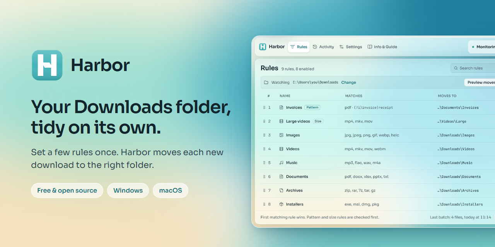
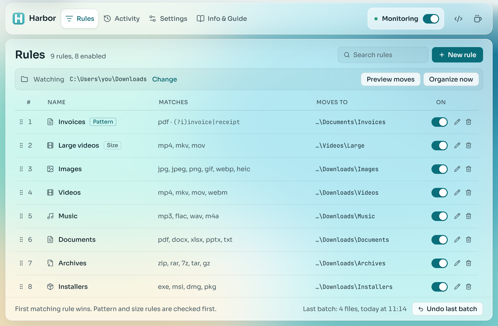
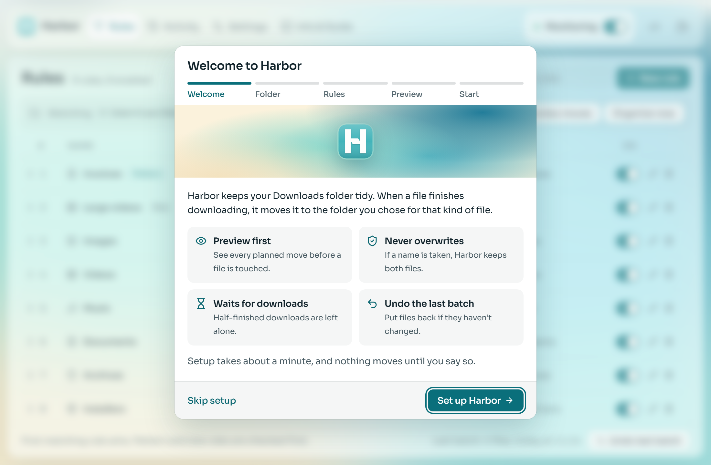
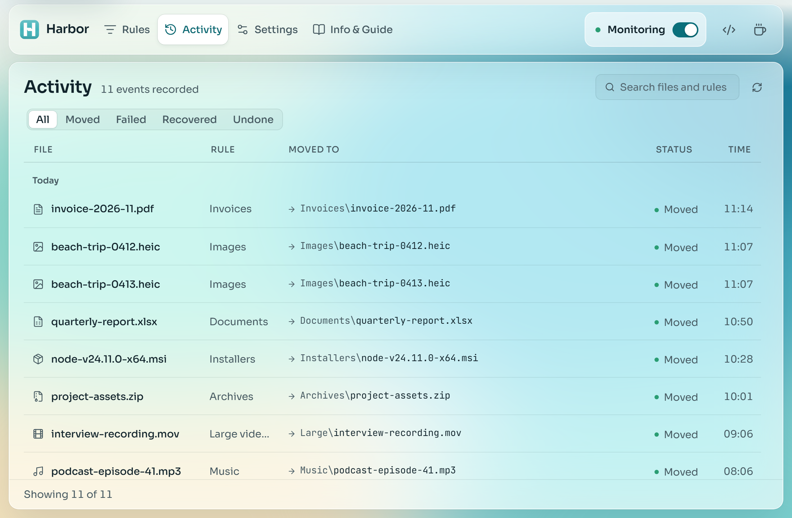
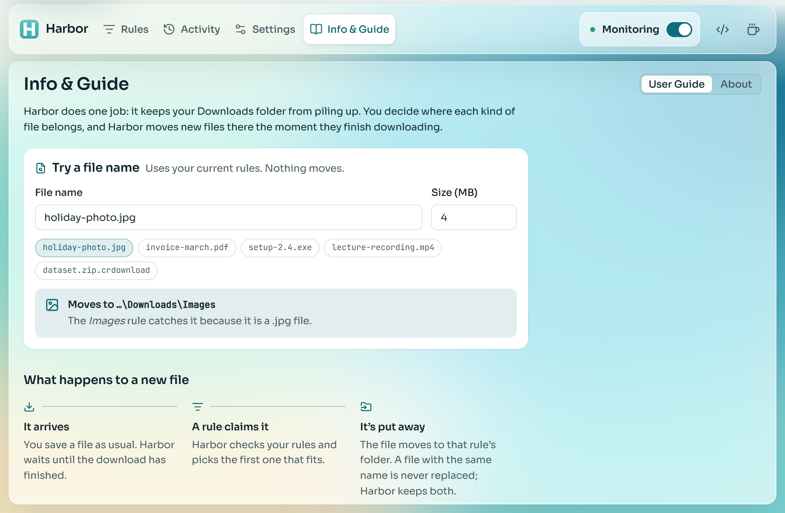
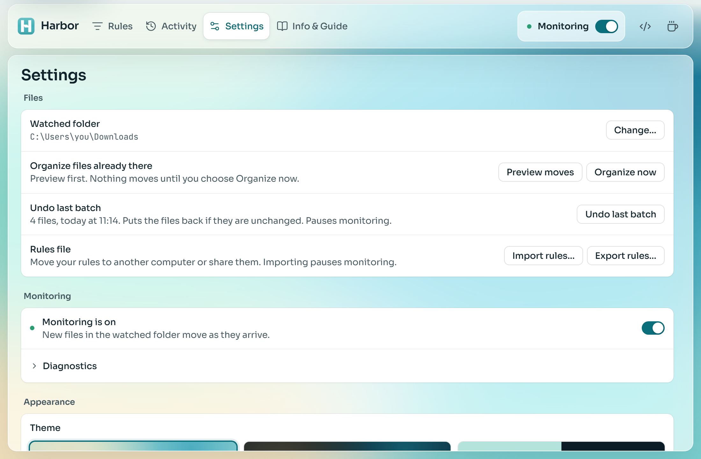

<h3>A free, open-source download organizer for Windows and macOS. 
Set a few rules once and Harbor quietly files every new download where it belongs.</h3>

&nbsp;

<a href="https://github.com/eduard-lt/Harbor-Download-Organizer/releases/latest">All release files and SHA-256 checksums</a> · <a href="#install">Install notes</a> · <a href="CHANGELOG.md">What's new</a>

 

<picture>
  <source media="(prefers-color-scheme: dark)" srcset="assets/screenshots/rules-dark.png">
  
</picture>

## How it works

| 1. Download | 2. Match | 3. Organize |
| :-- | :-- | :-- |
| Save files as you always do. Harbor waits until a download has finished, so half-written files are left alone. | Harbor checks your rules. Rules with a name pattern or size limit go first, then the first match wins. | The file moves to that rule's folder. If a file with the same name is already there, Harbor keeps both. |

## Why Harbor

- **Rules by extension, pattern or size.** Send `.pdf` files to Documents, anything matching `invoice|receipt` to Invoices, and videos over 500 MB to their own folder.
- **Preview before anything moves.** See every planned move for the files already in your folder, then choose *Organize now*.
- **Never overwrites.** A name clash never replaces an existing file, and partial downloads are skipped.
- **Undo the last batch.** Harbor puts the files back if they haven't changed since they were moved.
- **Try a file name.** Type a name in *Info & Guide* to see which rule would catch it and where it would go. Nothing moves.
- **Lives in the tray or menu bar.** Closing the window keeps Harbor running; *Quit* exits.
- **Launch at login**, minimized, so it's simply there.
- **Guided first run.** Sensible default rules, a preview of what they would do, and nothing moves until you start monitoring.
- **Searchable activity**, filtered by moved, failed, recovered and undone.
- **Free and open source.** MIT licensed, no account, no paywall.

## A closer look

<table>
<tr>
<td width="50%">
<picture>
  <source media="(prefers-color-scheme: dark)" srcset="assets/screenshots/setup-dark.png">
  
</picture>

<b>First-run setup</b> Folder, rules and a preview before you start.

</td>
<td width="50%">
<picture>
  <source media="(prefers-color-scheme: dark)" srcset="assets/screenshots/activity-dark.png">
  
</picture>

<b>Activity</b> Every move, searchable, with failures kept visible.

</td>
</tr>
<tr>
<td width="50%">
<picture>
  <source media="(prefers-color-scheme: dark)" srcset="assets/screenshots/info-dark.png">
  
</picture>

<b>Info &amp; Guide</b> Try a file name and see where it would go.

</td>
<td width="50%">
<picture>
  <source media="(prefers-color-scheme: dark)" srcset="assets/screenshots/settings-dark.png">
  
</picture>

<b>Settings</b> Watched folder, preview, undo, import and export.

</td>
</tr>
</table>

Screenshots use sample rules and files. They follow your GitHub theme; Harbor has light and dark modes too.

## Install

Harbor's installers are not code-signed yet, so Windows and macOS show a warning the first time you open them. That's expected. The [release page](https://github.com/eduard-lt/Harbor-Download-Organizer/releases/latest) lists SHA-256 checksums if you want to verify your download.

### Windows

1. Download **[Harbor-Windows-x64-Setup.exe](https://github.com/eduard-lt/Harbor-Download-Organizer/releases/latest/download/Harbor-Windows-x64-Setup.exe)**.
2. Run it. If SmartScreen says *Windows protected your PC*, choose **More info → Run anyway**. The installer is per-user and doesn't need administrator rights.
3. Harbor opens with a short setup. Pick your folder, review the rules, then start monitoring.

### macOS

1. Download **[Harbor-macOS-Universal.dmg](https://github.com/eduard-lt/Harbor-Download-Organizer/releases/latest/download/Harbor-macOS-Universal.dmg)** (Apple silicon and Intel, macOS 15 or later).
2. Open it and drag **Harbor** into **Applications**.
3. The first time, right-click Harbor in Applications and choose **Open**, or go to **System Settings → Privacy & Security** and click **Open Anyway**. Harbor then runs from the menu bar.

<!-- MACOS-WORKAROUND: if macOS reports "Harbor is damaged and can't be opened", document the
     temporary fix here (for example `xattr -cr /Applications/Harbor.app`) until the
     packaging fix ships. Remove this comment once release builds open normally. -->

To launch at login on macOS, approve Harbor in **System Settings → General → Login Items** if asked.

## FAQ

<b>Is Harbor really free?</b>

Yes. It's MIT licensed, with no account, no subscription and no paywall. All the source is here.

<b>Could Harbor lose or overwrite my files?</b>

Harbor never replaces an existing file: on a name clash it keeps both. It skips partial and very new downloads, and *Preview moves* shows what would happen before you organize existing files. *Undo last batch* restores files that are unchanged and refuses anything that would overwrite. It's a careful mover, not a backup tool, so keep backups of anything important.

<b>Why does my computer warn me about the installer?</b>

The builds aren't code-signed yet, so Windows SmartScreen and macOS Gatekeeper can't identify the publisher. Follow the [install steps](#install) to open it anyway, and compare the checksum on the release page if you'd like to verify the file.

<b>Does Harbor send anything over the internet?</b>

Organizing happens entirely on your computer. Harbor can check GitHub for new versions; turn off *Check for updates automatically* in Settings if you'd rather it didn't.

<b>Can it watch a folder other than Downloads?</b>

Yes. Choose any folder under **Settings → Watched folder**. Harbor watches one folder at a time.

<b>Can I move my rules to another computer?</b>

Use **Settings → Export rules…** and **Import rules…**. Importing pauses monitoring so you can review the rules before turning it back on.

<b>Is there a Linux version?</b>

Not at the moment. Harbor supports Windows and macOS.

## Configuration and recovery

Harbor keeps its rules (`harbor.downloads.yaml`), activity and undo journal in:

- **Windows:** `%LOCALAPPDATA%\Harbor`
- **macOS:** `~/Library/Application Support/Harbor`

Each successful edit keeps the previous valid file as `harbor.downloads.yaml.bak`. If the configuration becomes invalid, Harbor pauses and shows a recovery message instead of silently resetting it. Fix the file and use **Settings → Reload configuration**, restore the `.bak` while Harbor is closed, or reset in Settings (an invalid original is kept as `harbor-corrupt-*.yaml`).

Changing the watched folder, importing rules or undoing a batch pauses monitoring until you switch it back on.

## Contributing and docs

- [CHANGELOG.md](CHANGELOG.md): what changed in each version
- [CONTRIBUTING.md](CONTRIBUTING.md): building, testing and checks
- [docs/ARCHITECTURE.md](docs/ARCHITECTURE.md): how Harbor is put together
- [docs/RELEASE.md](docs/RELEASE.md): release checklist, signing status and validation notes

Harbor is built with [Tauri 2](https://tauri.app), Rust and React. Bug reports and ideas are welcome in [Issues](https://github.com/eduard-lt/Harbor-Download-Organizer/issues).

## License

Licensed under [MIT](LICENSE).
